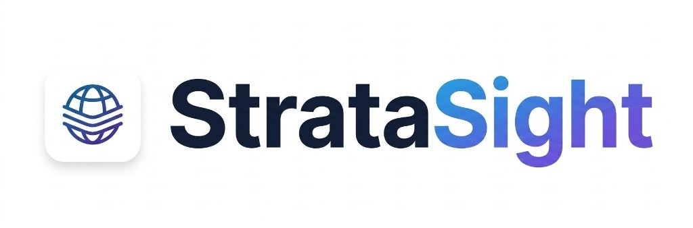
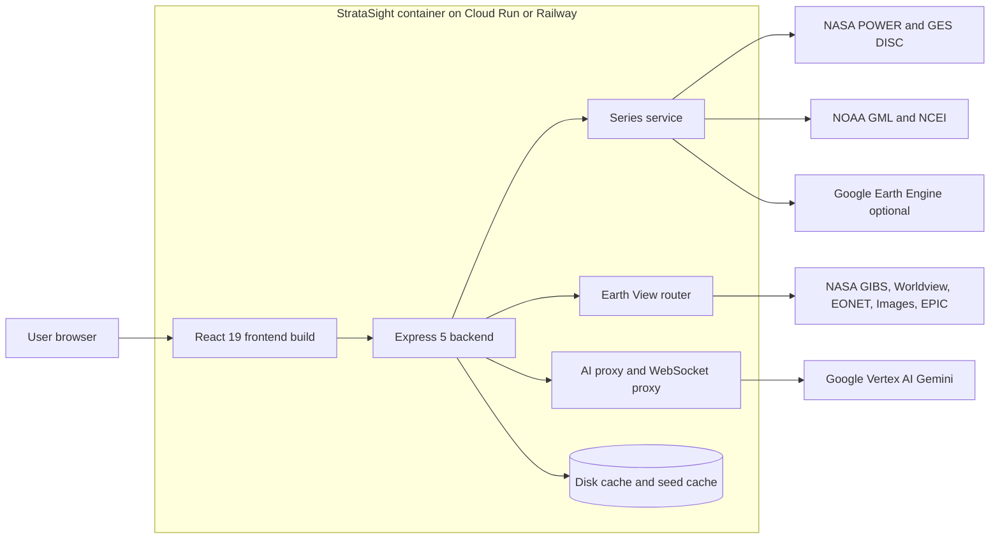
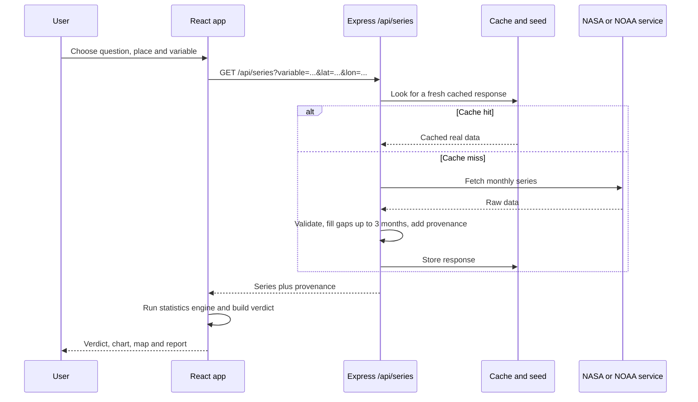
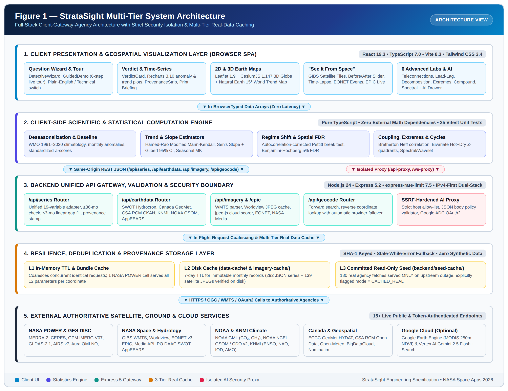
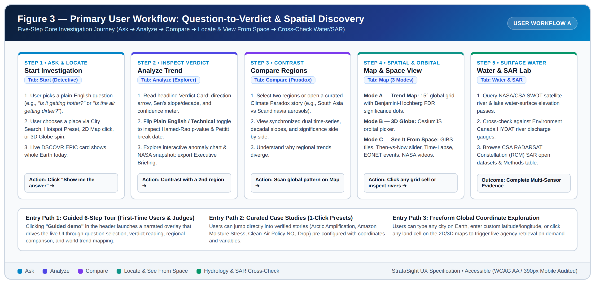

<p align="center"></p>

# StrataSight: is your part of the Earth changing?

**NASA Space Apps Challenge 2026: Be An Earth System Trend Detective**
Team StrataSight: Muhammad Arslan Toor (AI Engineer and Researcher) and Fatima Noor (Data Analyst and Researcher)

StrataSight turns decades of real NASA and partner agency observations into clear, trustworthy answers about environmental change. A user asks a plain question such as "Is it getting hotter?" or "Are soils drying out?", chooses a place, and receives a verdict, a chart, a map, satellite imagery and a statistical report, all explained in everyday language.

---

## Table of contents

1. [Overview](#1-overview)
2. [Key features](#2-key-features)
3. [Technology stack](#3-technology-stack)
4. [Architecture](#4-architecture)
5. [Installation and local setup](#5-installation-and-local-setup)
6. [Configuration](#6-configuration)
7. [Using the application](#7-using-the-application)
8. [Data sources](#8-data-sources)
9. [How the statistics work](#9-how-the-statistics-work)
10. [Backend API reference](#10-backend-api-reference)
11. [Integrations behind the scenes](#11-integrations-behind-the-scenes)
12. [Project structure](#12-project-structure)
13. [Testing and quality](#13-testing-and-quality)
14. [Deployment](#14-deployment)
15. [Security and secrets](#15-security-and-secrets)
16. [Troubleshooting](#16-troubleshooting)
17. [Known limitations](#17-known-limitations)
18. [Additional documentation](#18-additional-documentation)
19. [Attribution and licenses](#19-attribution-and-licenses)

---

## 1. Overview

The challenge asks four questions about any Earth system variable. StrataSight answers each one directly.

| The challenge asks | StrataSight answers with |
| --- | --- |
| **What** is changing? | A verdict headline and an arrow: rising, falling, or no clear trend |
| **Where** is it changing? | The exact grid cell analysed, plus a world trend map with significance dots |
| **How much** is it changing? | Sen's slope per decade with a 95% confidence interval, and the total change over the record |
| **Is it significant?** | A confidence meter built on an autocorrelation corrected Mann-Kendall test (Hamed-Rao), reported with its p-value |

> **Nothing is simulated.** Every series is fetched from the agency service named on its provenance strip. If a service is unreachable, the app says so, or shows an earlier real fetch clearly labelled `CACHED_REAL` with its original date.

---

## 2. Key features

- **Question first entry.** Guided questions lead to the right variable and region without needing scientific knowledge.
- **Verdict card.** A plain English or technical view of the same result, with a confidence meter.
- **Statistical report.** Mann-Kendall, Hamed-Rao, Sen's slope, seasonal tests, change point detection and more.
- **Trend map.** Real series sampled on a global land grid, with false discovery control.
- **See it from space.** NASA GIBS satellite layers, a before and after slider, a time-lapse, natural events and NASA media for the chosen place.
- **3D globe.** A CesiumJS globe streaming real NASA GIBS tiles.
- **Compare.** Two regions side by side, including stories where the same driver pushes two places in opposite directions.
- **Analysis labs.** Teleconnections (ENSO, NAO, PDO), lead and lag correlation, trend and season decomposition, extreme months, compound hot and dry events, and spectral cycles.
- **Water and SAR.** SWOT river altimetry, Canadian hydrometric gauges and CSA RADARSAT Constellation scene metadata.
- **AI Climatologist (optional).** Gemini on Google Vertex AI explains the results. The drawer hides itself when AI is not configured.
- **Methods page.** A provenance table generated from the variable catalog, plus an honest list of what the tool cannot tell you.
- **Resilience.** Shared upstream requests, stale while error caching, and a committed seed cache for demos.
- **Accessibility.** Keyboard controls, aria labels, live regions, reduced motion support, visible focus rings and a text readout beside every map.

---

## 3. Technology stack

| Layer | Technology | Purpose |
| --- | --- | --- |
| Frontend framework | React 19 with TypeScript (strict mode) | User interface |
| Build tool | Vite 8 | Development server and production build |
| Styling | Tailwind CSS 3 | Responsive, accessible design system |
| Charts | Recharts | Time series and statistical charts |
| 2D maps | Leaflet | Satellite map workspace and place picker |
| 3D globe | CesiumJS | Globe with NASA GIBS imagery layers |
| Motion and icons | Framer Motion, Lucide React | Animation and iconography |
| Geographic data | world-atlas, topojson-client (Natural Earth) | Coastlines and land grid |
| AI client | Google GenAI SDK | Optional AI Climatologist |
| Backend framework | Express 5 on Node.js (ES modules) | API gateway and static hosting |
| Backend libraries | express-rate-limit, node-fetch, ws, jpeg-js, dotenv | Rate limits, upstream calls, WebSocket proxy, image analysis, configuration |
| Google libraries | google-auth-library, @google/earthengine | Vertex AI authentication and optional MODIS NDVI |
| Testing | Vitest (frontend), Node test runner (backend) | Unit tests |
| Packaging | npm workspaces, Docker | Monorepo and container deployment |
| Hosting | Google Cloud Run or Railway | Single container full stack deployment |

Requires **Node.js 20.18 or newer** (22.9 or newer recommended).

---

## 4. Architecture

StrataSight is a monorepo with two workspaces. In production, one Docker container runs the Express backend and serves the built React app from the same origin, so there are no cross origin settings to manage.



### Request flow for a trend answer



Pre drawn diagrams are available in [`docs/diagrams`](docs/diagrams) and in the Word documentation (see [Additional documentation](#18-additional-documentation)).

<p align="center">
  
</p>

<p align="center">
  
</p>

### Design principles

- **Real data only.** Variables whose provider is not configured are hidden, never faked.
- **Provenance everywhere.** Agency, product, endpoint, license, resolution, DOI where one exists, record dates and interpolated month count travel with every series.
- **Graceful failure.** If an agency fails, an earlier real response for the exact request is served as `CACHED_REAL`. A committed `backend/seed-cache/` covers demo stories.
- **Performance.** The main JavaScript bundle is about 390 kB (124 kB gzipped). The 3D globe, Gemini SDK, map and labs load on demand.

---

## 5. Installation and local setup

### 5.1 Prerequisites

- Node.js 20.18 or newer and npm
- Git
- Optional: Docker, for container testing
- Optional: a free NASA Earthdata account, for extra variables

### 5.2 Get the code

```bash
git clone https://github.com/NasaSpace-challenge/strata-sight.git
cd strata-sight
```

### 5.3 Install dependencies

The repository uses npm workspaces. One command installs both the frontend and the backend.

```bash
npm install
```

### 5.4 Run in development

```bash
npm run dev
```

This starts two processes:

| Process | Address |
| --- | --- |
| Frontend (Vite) | http://localhost:5173 |
| Backend (Express) | http://localhost:5000 |

Vite proxies `/api`, `/api-proxy` and `/ws-proxy` to the backend, so the browser only talks to port 5173.

No API keys are needed for the core experience (NASA POWER with MERRA-2, and NOAA GML). Additional variables need optional keys, described in [Configuration](#6-configuration).

### 5.5 Optional: warm the cache

For a fast first load on a fresh machine, pre fetch the demo data. This takes about one to two minutes.

```bash
npm run warm
```

### 5.6 Run the production build locally

```bash
npm run build
node backend/server.js
```

When `frontend/dist` exists, the backend serves the app at the address it prints (port 5000 by default).

### 5.7 Run with Docker

```bash
docker build -t stratasight .
docker run --rm -p 8080:8080 --env-file backend/.env.local stratasight
```

Open http://localhost:8080.

---

## 6. Configuration

Copy `backend/.env.example` to `backend/.env.local` and fill in what you have. Everything is optional. The app runs without any file.

| Variable | Required | Purpose |
| --- | --- | --- |
| `API_BACKEND_HOST` | No | Listen address. Defaults to `127.0.0.1` locally and `0.0.0.0` when `PORT` is set |
| `API_BACKEND_PORT` | No | Local port. Defaults to `5000`. A `PORT` variable (Cloud Run, Railway) takes priority |
| `API_PAYLOAD_MAX_SIZE` | No | Maximum JSON body size. Defaults to `7mb` |
| `EARTHDATA_TOKEN` | No | NASA Earthdata bearer token. Unlocks GPM IMERG, GLDAS, AIRS and OMI variables. Generate one free at [urs.earthdata.nasa.gov](https://urs.earthdata.nasa.gov/users/tokens) |
| `NOAA_CDO_TOKEN` | No | NOAA Climate Data Online token. Request one free at [ncei.noaa.gov](https://www.ncei.noaa.gov/cdo-web/token) |
| `GOOGLE_CLOUD_PROJECT` | No | Google Cloud project for Vertex AI (AI Climatologist) and Earth Engine |
| `GOOGLE_CLOUD_LOCATION` | No | Vertex AI region, for example `europe-west4` |
| `PROXY_HEADER` | No | Shared value that must equal the `X-App-Proxy` header in `frontend/vertex-ai-proxy-interceptor.js` |
| `GOOGLE_SERVICE_ACCOUNT_JSON` | No | Full service account JSON for Vertex AI when Application Default Credentials are not available |
| `EE_PROJECT_ID` | No | Earth Engine project for optional MODIS NDVI |
| `EE_SERVICE_ACCOUNT_KEY_FILE` | No | Path to an Earth Engine service account key file (local use) |
| `EE_SERVICE_ACCOUNT_KEY_JSON` | No | Full Earth Engine key JSON (container and cloud use) |
| `STRATASIGHT_CACHE_DIR`, `STRATASIGHT_SEED_DIR`, `STRATASIGHT_IMAGERY_DIR` | No | Custom cache locations (the older `EARTHPULSE_*` names still work) |
| `FRONTEND_DIST` | No | Custom path to the built frontend |

What each optional service unlocks:

| Service | Unlocks |
| --- | --- |
| Earthdata token | GPM IMERG precipitation, GLDAS soil moisture, AIRS skin temperature, OMI NO2 |
| Vertex AI settings plus `gcloud auth application-default login` | The AI Climatologist drawer |
| Earth Engine settings | MODIS NDVI (hidden unless the project is registered) |
| NOAA CDO token | NOAA Climate Data Online lookups |

Never commit `backend/.env.local` or `backend/ee-service-account.json`. Both are git ignored.

---

## 7. Using the application

The header holds the main tabs. A **Guided demo** button runs a narrated six step tour.

| Tab | What it does |
| --- | --- |
| **Start** | Choose a plain question, then a place, then see the answer |
| **Analyze** | Verdict card, chart, plain English or technical view, full statistical report |
| **Compare** | Two regions side by side and curated stories |
| **Map** | Trend map, place explorer and the See it from space mode |
| **Water and SAR** | SWOT river altimetry, Canadian gauges, CSA RCM catalog |
| **Labs** | Teleconnections, lead and lag, decomposition, extreme months, compound events, spectral cycles |
| **Methods** | Data provenance table, statistics, and limitations |

### Suggested judge path

1. **Start.** Choose "Is the air getting dirtier or cleaner?", then Indo-Gangetic Plain, then **Show me the answer**.
2. **Analyze.** Read the verdict card. Switch between Plain English and Technical. Open the full statistical report.
3. **Compare.** Open the story "Two Paths for Air Pollution". Aerosols rise over South Asia and fall over Scandinavia.
4. **Map.** Open "Where is it changing?". Red appears over India and blue over eastern China. Click any square to analyze it.
5. **See it from space.** Choose a place and explore NASA imagery, events and media.
6. **Methods.** Review the provenance table and the limits of the tool.

---

## 8. Data sources

### 8.1 Trend variables

| Variable | Product or instrument | Agency | Record | Resolution | Provider |
| --- | --- | --- | --- | --- | --- |
| Near surface air temperature | MERRA-2 (via NASA POWER) | NASA GMAO | 1981 to present | 0.5° × 0.625° | POWER |
| Daytime maximum and nighttime minimum temperature | MERRA-2 (via NASA POWER) | NASA GMAO | 1981 to present | 0.5° × 0.625° | POWER |
| Land and sea skin temperature | MERRA-2 (via NASA POWER) | NASA GMAO | 1981 to present | 0.5° × 0.625° | POWER |
| Sunlight reaching the surface | CERES SYN1deg (via NASA POWER) | NASA LaRC | 1981 to present | 1° × 1° | POWER |
| Cloud cover | MERRA-2 and CERES (via NASA POWER) | NASA GMAO and LaRC | 1981 to present | 0.5° × 0.625° | POWER |
| Relative humidity, wind speed, total column ozone | MERRA-2 (via NASA POWER) | NASA GMAO | 1981 to present | 0.5° × 0.625° | POWER |
| Aerosol optical depth (550 nm) | MERRA-2 aerosol reanalysis | NASA GMAO | 2001 to present | 0.5° × 0.625° | POWER |
| Precipitation (gauge corrected), root zone soil wetness | MERRA-2 (via NASA POWER) | NASA GMAO | 1981 to present | 0.5° × 0.625° | POWER |
| Tropospheric NO2 | OMI on Aura | NASA GSFC and KNMI | 2004 to present | 0.25° × 0.25° | GES DISC |
| Monthly precipitation | GPM IMERG Final | NASA and JAXA | 2000 to present | 0.1° × 0.1° | GES DISC |
| Root zone soil moisture | GLDAS-2.1 Noah | NASA GSFC | 2000 to present | 0.25° × 0.25° (land) | GES DISC |
| Satellite skin temperature | AIRS on Aqua | NASA JPL | 2002 to present | 1° × 1° | GES DISC |
| Atmospheric CO2 | Mauna Loa Observatory | NOAA GML | 1958 to present | Global mean | NOAA GML |
| Atmospheric methane | Global marine surface network | NOAA GML | 1984 to present | Global mean | NOAA GML |
| Vegetation greenness (NDVI), optional | MODIS on Terra | NASA LP DAAC | 2001 to present | 250 m | Earth Engine |

The same table, with per variable caveats, is generated live in the app's **Methods** tab from the variable catalog, so it cannot drift from the code.

### 8.2 Satellite imagery and Earth views

| View | Source |
| --- | --- |
| Satellite map: Terra, Aqua and NOAA-20 true colour, plus heat, air pollution, NO2, rain, greenness and night lights | NASA GIBS (Worldview tiles) |
| Before and after slider and a daily time-lapse | NASA GIBS and Worldview Snapshots, cached by the backend |
| Natural events near a place (wildfires, storms, volcanoes, floods, sea ice) | NASA EONET |
| Pictures and videos tagged with a place | NASA Image and Video Library |
| "Earth right now" on the Start page | NASA EPIC on DSCOVR |
| 3D globe | NASA GIBS tiles drawn with CesiumJS |

Satellite pictures are daily snapshots that are hours to two days old, not live video. Cloud cover is estimated from a small preview and is labelled as an estimate.

### 8.3 Water, SAR and partner data

| Source | Use |
| --- | --- |
| NASA PO.DAAC Hydrocron (SWOT) | River altimetry time series |
| Environment and Climate Change Canada MSC GeoMet | Hydrometric gauge monthly means |
| Canadian Space Agency RADARSAT Constellation Mission (via Open Government Canada) | SAR scene catalog metadata |
| NASA LP DAAC AppEEARS | Product catalog |
| NOAA NCEI Climate Data Online and Global Summary of the Month | Station climate records |
| KNMI Climate Explorer | ENSO, NAO, PDO, DMI and AMO climate indices |
| Open-Meteo, OpenStreetMap Nominatim, BigDataCloud | Place search and reverse geocoding |

### 8.4 Complete resource links

**NASA data and services**

| Name | URL |
| --- | --- |
| NASA POWER | https://power.larc.nasa.gov/ |
| NASA Earthdata Login | https://urs.earthdata.nasa.gov/ |
| NASA GES DISC Giovanni | https://giovanni.gsfc.nasa.gov/ |
| NASA GES DISC Hydrology Data Rods | https://disc.gsfc.nasa.gov/information/tools?title=Hydrology%20Time%20Series |
| NASA LP DAAC AppEEARS | https://appeears.earthdatacloud.nasa.gov/ |
| NASA GIBS | https://gibs.earthdata.nasa.gov/ |
| NASA Worldview | https://worldview.earthdata.nasa.gov/ |
| NASA EONET | https://eonet.gsfc.nasa.gov/ |
| NASA Image and Video Library | https://images.nasa.gov/ |
| NASA EPIC on DSCOVR | https://epic.gsfc.nasa.gov/ |
| NASA PO.DAAC Hydrocron (SWOT) | https://soto.podaac.earthdatacloud.nasa.gov/hydrocron/v1/timeseries |
| NASA GMAO MERRA-2 | https://gmao.gsfc.nasa.gov/reanalysis/MERRA-2/ |
| NASA LaRC CERES | https://ceres.larc.nasa.gov/ |

**Partner and other sources**

| Name | URL |
| --- | --- |
| NOAA Global Monitoring Laboratory | https://gml.noaa.gov/ |
| NOAA NCEI Climate Data Online | https://www.ncei.noaa.gov/cdo-web/ |
| KNMI Climate Explorer | https://climexp.knmi.nl/ |
| Canadian Space Agency RCM data | https://donnees-data.asc-csa.gc.ca/en/dataset/rcm |
| ECCC MSC GeoMet | https://api.weather.gc.ca/ |
| Open-Meteo Geocoding | https://open-meteo.com/en/docs/geocoding-api |
| Google Earth Engine | https://earthengine.google.com/ |
| Google Vertex AI | https://cloud.google.com/vertex-ai |
| CesiumJS | https://cesium.com/cesiumjs/ |
| Leaflet | https://leafletjs.com/ |

---

## 9. How the statistics work

All statistics run in a tested TypeScript engine (`frontend/services/statisticsEngine.ts`). The verdict logic (`verdict.ts`) turns the numbers into plain language.

| Method | Used for |
| --- | --- |
| Mann-Kendall with tie correction | Trend detection |
| Hamed-Rao modified Mann-Kendall | Authoritative p-value under serial correlation |
| Sen's slope with Gilbert confidence interval | Size of change per decade |
| Seasonal Mann-Kendall and STL style decomposition | Seasonal robustness, and the split into signal, season and noise |
| Pettitt test (autocorrelation corrected) | Abrupt change point |
| Benjamini-Hochberg false discovery rate | Field significance on the trend map |
| Bretherton effective sample size correlation | Lead and lag links and teleconnections (ENSO, NAO, PDO) |

Why this matters:

- **Autocorrelation is handled.** Monthly climate data remember last month, which makes the plain Mann-Kendall test overconfident. Verdicts use the Hamed-Rao modified test. The plain p-value is shown only for comparison.
- **Multiple testing is handled.** The trend map tests many places at once. Dots mark only cells that survive false discovery control at 5%.
- **Gaps are honest.** Gaps up to three months are linearly interpolated and flagged. Longer gaps are never papered over.
- **Limits are stated.** A detected trend is not attributed to a cause. Short satellite records can mimic trends. Reanalysis is a model assisted estimate. These notes appear next to every verdict.

---

## 10. Backend API reference

All routes are served by the Express backend. They are read only `GET` routes unless noted.

| Route | Purpose |
| --- | --- |
| `/api/series` | Unified real data time series gateway (query: `variable`, `lat`, `lon`) |
| `/api/series/catalog` | Variable catalog and provider availability |
| `/api/timeseries` | Raw Earth Engine route (rate limited, for scripts and tests) |
| `/api/earthdata/health` | Status of each live data provider |
| `/api/earthdata/nasa-power` | NASA POWER monthly point data |
| `/api/earthdata/gesdisc-datarods` | GES DISC hydrology data rods (needs Earthdata token) |
| `/api/earthdata/swot-hydrocron` | SWOT river altimetry |
| `/api/earthdata/canada-geomet` | Canadian hydrometric stations |
| `/api/earthdata/noaa-gml` | NOAA CO2 and CH4 records |
| `/api/earthdata/noaa-cdo` | NOAA Climate Data Online (needs token) |
| `/api/earthdata/noaa-ncei-gsom` | NOAA Global Summary of the Month |
| `/api/earthdata/appeears-catalog` | AppEEARS product catalog |
| `/api/earthdata/knmi-index` | KNMI climate indices |
| `/api/earthdata/csa-rcm-catalog` | CSA RCM scene catalog |
| `/api/earthdata/verify-keys` | Checks which optional keys are configured |
| `/api/imagery/layers` | GIBS layer catalog with live date ranges |
| `/api/imagery/snapshot` | Still image of a place and date |
| `/api/imagery/best` | Clearest recent days for a place |
| `/api/events` | Natural events near a place (NASA EONET) |
| `/api/media`, `/api/media/asset` | NASA media for a place and playable video URL |
| `/api/epic/latest`, `/api/epic/dates`, `/api/epic/day` | DSCOVR EPIC whole Earth images |
| `/api/geocode`, `/api/geocode/reverse`, `/api/geocode/country` | Place search and reverse lookup |
| `/api/ai/status` | Tells the UI whether the AI Climatologist is available |
| `/api-proxy` (`POST`) | Proxy to Vertex AI Gemini (needs the proxy header) |
| `/ws-proxy` (WebSocket) | Live AI streaming proxy |

---

## 11. Integrations behind the scenes

**Series gateway.** `backend/seriesService.js` contains one adapter per provider (NASA POWER, Giovanni, NOAA GML, Earth Engine). Each adapter returns the same shape: a monthly series plus provenance. The service merges simultaneous identical requests into one upstream call, fills gaps up to three months, and stores each response on disk. If a live call fails, it returns the last real response marked `CACHED_REAL`, then falls back to the committed `backend/seed-cache/`.

**Earth view router.** `backend/earthViewRouter.js` proxies NASA GIBS, Worldview Snapshots, EONET, the Image and Video Library and EPIC. It validates inputs, applies time limits and rate limits, and caches downloaded snapshots in `backend/imagery-cache/`. It estimates cloud cover from a tiny preview image to suggest the clearest recent days.

**AI Climatologist.** The browser sends Gemini requests to `/api-proxy`. The backend checks the proxy header, blocks unsafe targets, adds Google credentials (Application Default Credentials or `GOOGLE_SERVICE_ACCOUNT_JSON`), and forwards the request to Vertex AI. Streaming sessions use `/ws-proxy`. Nothing in the browser holds a Google credential.

**Earth Engine (optional).** `backend/datasets.js` signs in with a service account key (file or `EE_SERVICE_ACCOUNT_KEY_JSON`) and reads MODIS NDVI. A health check hides the variable if the project is not registered.

**Rate limiting.** Each route group has its own limit, to protect upstream services and the deployment.

---

## 12. Project structure

```
.
├── Dockerfile                    Single container build for Cloud Run or Railway
├── .dockerignore                 Keeps secrets and caches out of the image
├── package.json                  npm workspaces and root scripts
├── frontend/                     React 19 + Vite + TypeScript
│   ├── components/               Verdict card, trend map, wizard, globe, labs
│   ├── services/                 Statistics engine, verdict logic, data clients, tests
│   ├── public/                   Brand assets, favicon, manifest
│   └── vite.config.ts            Dev proxy, Cesium asset copy
├── backend/                      Express 5 gateway
│   ├── server.js                 Routes, AI proxy, WebSocket proxy, static hosting
│   ├── seriesService.js          Provider adapters, caching, provenance
│   ├── earthViewRouter.js        Imagery, events, media, EPIC
│   ├── earthdataRouter.js        Multi agency live data routes
│   ├── datasets.js               Earth Engine integration
│   ├── seed-cache/               Read only seed of real fetches
│   └── .env.example              Configuration template
├── scripts/                      Cache warming and documentation tools
└── docs/                         Diagrams and Word documentation
```

---

## 13. Testing and quality

| Command | Does |
| --- | --- |
| `npm run dev` | Frontend and backend with hot reload |
| `npm test` | Statistics and imagery logic unit tests (frontend and backend) |
| `npm run typecheck` | Strict TypeScript check |
| `npm run build` | Production build of the frontend |
| `npm run warm` | Pre fetch demo data into the local cache |
| `npm run seed` | Refresh the committed read only seed |

The statistics engine is tested against textbook values and seeded synthetic signals. This includes a regression test that autocorrelated noise is not reported as a structural break. The imagery logic has its own tests.

---

## 14. Deployment

The `Dockerfile` builds the React app and serves it together with the API and the AI WebSocket proxy from one container. It listens on the `PORT` provided by the host and runs as a non root user.

### 14.1 Google Cloud Run

```bash
PROJECT=your-gcp-project
REGION=europe-west4
gcloud config set project $PROJECT
gcloud services enable run.googleapis.com cloudbuild.googleapis.com artifactregistry.googleapis.com aiplatform.googleapis.com

gcloud run deploy stratasight --source . --region $REGION --allow-unauthenticated \
  --timeout 3600 --memory 1Gi \
  --set-env-vars GOOGLE_CLOUD_PROJECT=$PROJECT,GOOGLE_CLOUD_LOCATION=$REGION,EE_PROJECT_ID=$PROJECT,PROXY_HEADER=oXPOjRawoER8LMDU9sHEqj4aPa-bA5Lv \
  --set-secrets EARTHDATA_TOKEN=earthdata-token:latest,NOAA_CDO_TOKEN=noaa-cdo-token:latest,EE_SERVICE_ACCOUNT_KEY_JSON=ee-key:latest
```

Notes:

- Vertex AI uses the Cloud Run service account through Application Default Credentials. Grant it the **Vertex AI User** role. No key file is needed.
- The Earth Engine key is read from `EE_SERVICE_ACCOUNT_KEY_JSON`. You can also set plain environment variables in the Cloud Run console.
- Secrets are never baked into the image.
- The disk cache is per instance and is lost on restart. The bundled `seed-cache` is the offline fallback.
- If a region hits a quota limit, try `europe-west1` or `europe-west9`.

### 14.2 Railway

Create a service from the repository root and choose the Dockerfile build. Add the same environment variables in the Railway dashboard. Railway sets `PORT` automatically. Setting the service root to `backend` deploys the API only.

---

## 15. Security and secrets

- Keys and service account files are read from environment variables. They are never committed.
- `.env`, `.env.*`, `backend/.env.local` and any `*service-account*.json` file are git ignored and excluded from the Docker image.
- The AI proxy requires a matching `PROXY_HEADER`, blocks unapproved target hosts, and is rate limited.
- The container runs as a non root user.
- If a key or token was ever committed, rotate it immediately.

---

## 16. Troubleshooting

| Problem | What to check |
| --- | --- |
| Some variables are missing | Their provider is not configured. Add `EARTHDATA_TOKEN` or the Earth Engine settings, then restart |
| The AI Climatologist says it is unavailable | Set `GOOGLE_CLOUD_PROJECT`, `GOOGLE_CLOUD_LOCATION` and `PROXY_HEADER`, and make sure credentials exist |
| AI requests return an error | `PROXY_HEADER` must equal the `X-App-Proxy` value in `frontend/vertex-ai-proxy-interceptor.js` |
| First load is slow | Run `npm run warm` to pre fetch demo data |
| Globe tiles do not load | Check the network connection to `gibs.earthdata.nasa.gov` |
| A data source is slow or down | The app serves an earlier real response labelled `CACHED_REAL` when one exists |
| Port already in use | Change `API_BACKEND_PORT` or stop the other process |
| Cloud Run quota error | Deploy to another region such as `europe-west1` |

---

## 17. Known limitations

- Trend map cells are sampled on a 15° grid by cell centre land test, so some coastal cells are omitted. Neighbouring cells are correlated, so the false discovery correction is approximate.
- Satellite era records (10 to 25 years) can be dominated by natural cycles such as El Niño.
- The CSA RCM scene values in the Water and SAR tab are illustrative scene metadata, labelled as such, not a processed time series.
- StrataSight detects change. It does not attribute it to a cause.
- Satellite pictures are daily snapshots, not live video. The cloud percentage is an estimate from a small preview. NASA's media library only covers some places.

---

## 18. Additional documentation

- Word document: [`docs/StrataSight-Documentation/StrataSight-Technical-Documentation.docx`](docs/StrataSight-Documentation/StrataSight-Technical-Documentation.docx) with architecture, workflow and integration diagrams
- Diagram images: [`docs/diagrams`](docs/diagrams) and [`docs/StrataSight-Documentation/diagrams`](docs/StrataSight-Documentation/diagrams)
- Regenerate the Word document: `python3 scripts/generate-docs.py` (requires `python-docx` and `Pillow`)

---

## 19. Attribution and licenses

Contains information licensed under the Open Government Licence Canada. NASA POWER, GES DISC, PO.DAAC and NOAA data are used under their open data policies with source citation. KNMI Climate Explorer indices are used for scientific and educational purposes.

NASA does not endorse any non-U.S. Government entity and is not responsible for information on non-U.S. Government websites.

Coastlines: Natural Earth via `world-atlas`. Open source libraries are used under their respective licenses.
